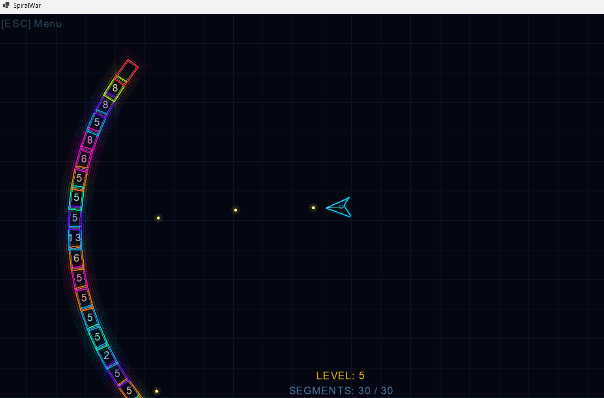

# SpiralWar

SpiralWar is an arcade survival shooter built with **C#** and **MonoGame**. One ship, bolted to
the core of a neon arena. A segmented snake spirals in from off-screen. Destroy every ring
before the head reaches the middle - you have exactly three minutes.



## Features

* **100 levels, three minutes each.** The spiral always takes 180 seconds to reach the core, so
  the fail timer is something you learn rather than something that shifts under you. The health
  pool of every level is derived from it.
* **Five snake forms.** The spiral changes shape five times across the campaign - SWARM (a long
  tail of small fragile rings) through to BULWARK (a short column of enormous, heavily plated
  ones). The form changes how a level feels, not how long it takes.
* **Neon dynamite.** Some rings are charges. Shoot one and everything around it goes up, and any
  charge caught in the blast chains. A well-placed shot can unzip a quarter of the snake.
* **Six supplies that change the gun.** Double, triple and diffused fire; homing missiles that
  actually have to steer; a stasis field that slows the whole spiral; and repair.
* **Four neon diamonds that change the numbers.** Blue attack speed, black criticals, green
  acidic rounds that keep eating a ring after you have looked away, red power attack with
  piercing. They stack to level 3 and run on their own timers alongside the supplies.
* **Readable damage.** A base bullet deals exactly 1. Everything that exceeds that - crits,
  power, acid, missiles, blasts - announces itself in its own colour with its own sound, so you
  can always account for what came off a ring.
* **Carrier rings.** A ring wears the glyph of what it will drop from the moment it appears, so
  choosing what to shoot is a real decision instead of a lottery.
* **Fully procedural presentation.** Every visual is drawn from a single white texel, and every
  sound is synthesized at start-up. There is not one art or audio file in this repository.
* **Desktop and mobile from one project.** Authored at 1280x720 and letterboxed onto any back
  buffer; mouse, touch, keyboard and gamepad all arrive through one device-neutral input layer.
* **Persistent profile.** Settings and progression as readable JSON, with a per-installation
  GUID for support and future cloud features.

## Controls

| | |
|---|---|
| Aim | Move the pointer / touch |
| Fire | Hold left button / hold touch |
| Navigate menus | Arrows, W/S, D-pad, or pointer |
| Confirm | Enter, Space, A |
| Back / pause | Escape, B, Android back |

## Technologies

* **Language:** C# (.NET 9)
* **Framework:** MonoGame 3.8
* **Architecture:** shared project (`SpiralWar.Shared`) driving platform head projects

## Getting started

```bash
git clone https://github.com/arargames/SpiralWar.git
```

1. Open `SpiralWar.sln` in Visual Studio or Rider.
2. Set `SpiralWar.Desktop` as the startup project.
3. Build and run.

## Project layout

```
SpiralWar.Shared/     all gameplay, rendering, audio and UI
  Core/               pooling, config, input, virtual viewport
  Audio/              procedural synthesizer and sound bank
  Levels/             the 100 level curve and the five snake forms
  Entities/           player, snake, rings, bullets, missiles, supplies, diamonds, particles
  Rendering/          primitives, neon, HUD, draw context
  Screens/            screen stack and every screen
  Systems/            collision, bullets, missiles, supplies, diamonds, detonation, particles
SpiralWar.Desktop/    Windows head project
docs/                 technical documentation - read before changing an area
```

## Documentation

Detailed technical notes live in [`docs/`](docs/README.md): design goals, architecture, the
three minute level design with its full generated table, the ring payload systems, every sound
recipe, the rendering approach and the persistence format.

## Contributing

Code, comments and commit messages are English. SOLID, DRY and YAGNI are taken seriously here.
Before working on an area, read its document in `docs/`; after finishing, update it.
